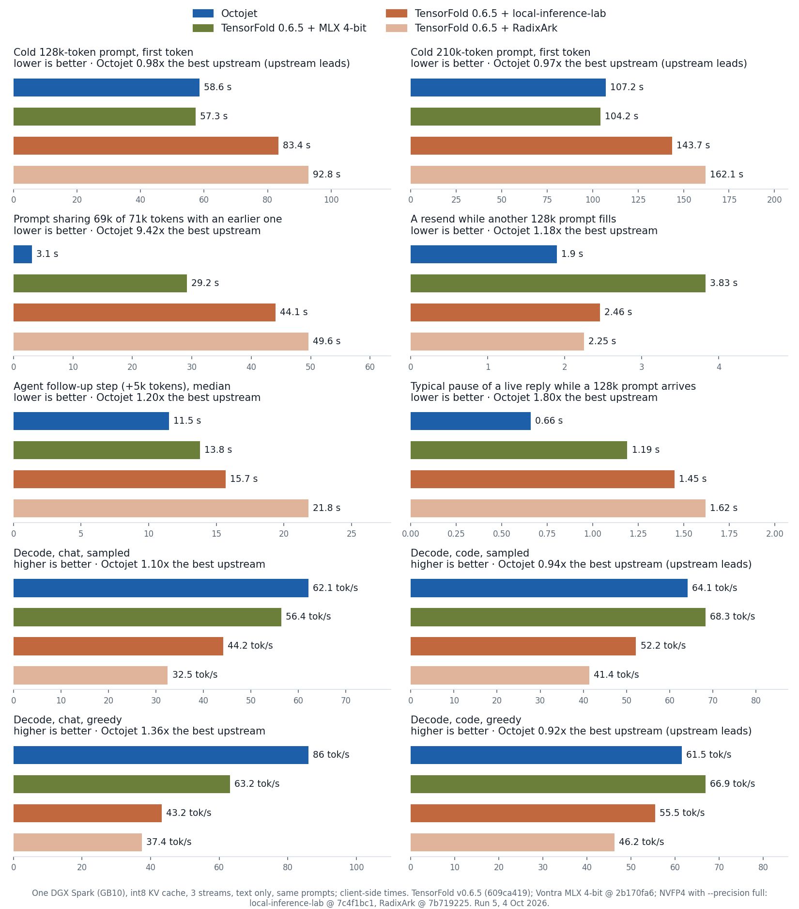
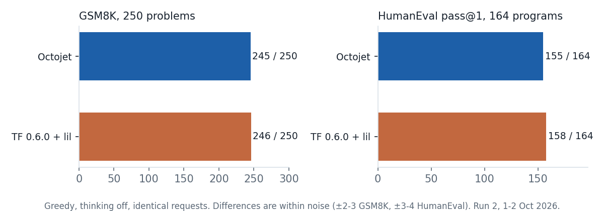
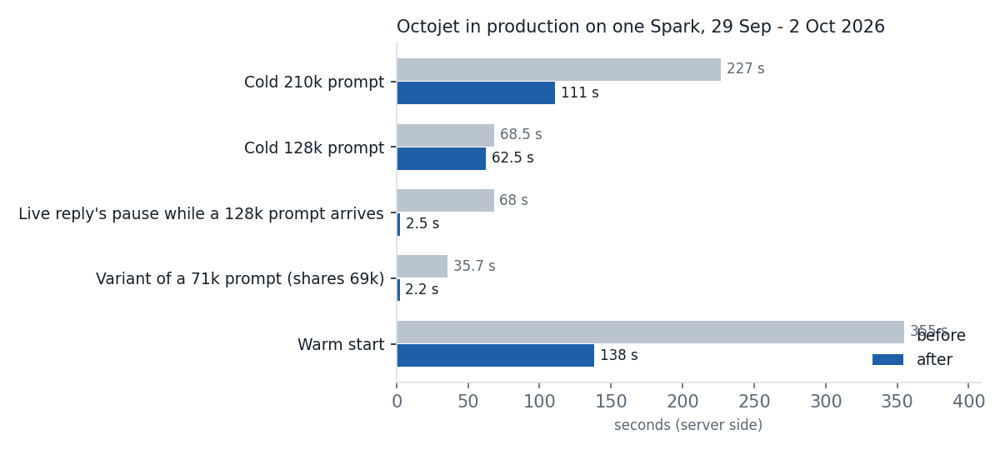

# Octojet

Octojet is an LLM inference engine for NVIDIA GB10 systems (DGX Spark), by Octolix. It is a fork of
[TensorFold](https://github.com/ashhart/TensorFold) 0.3.6.2 (commit 71377a5, MIT), tuned for one workload: Qwen3.8
Flash Next with native FP4 (NVFP4) routed experts, serving agent-style traffic (long prompts, follow-up turns, short
replies) on one GB10 box. Drafted decoding stays exact: every drafted reply equals what serial decoding produces with
the same settings.

What the fork adds to TensorFold 0.3.6.2: NVFP4 routed experts in TensorFold's grouped-expert kernels, a mixed
NVFP4 + MLX 4-bit checkpoint, an on-disk cache of packed expert tables, faster long prompts, prefix reuse (identical
prompts and shared prefixes), image and video input, prompts that prefill inside decode rounds, and tools that build
and check the published checkpoint. The full list is in [`engine/CHANGELOG.md`](engine/CHANGELOG.md).

**On one DGX Spark, against TensorFold v0.6.5 (its latest release) on the three published Flash Next checkpoints it
serves:** Octojet answers prompts that repeat or share a long prefix with an earlier one far sooner (a variant of a 71k
prompt in 3.1 s against 29.2 s at best; a resend arriving while another long prompt fills in 1.9 s against 2.2 s), keeps
live replies smoother while a long prompt arrives (typical pause 0.66 s against 1.19 s), finishes agent follow-up steps
sooner (11.5 s against 13.8 s) and decodes chat faster. TensorFold on Vontra's MLX 4-bit checkpoint reads cold prompts
sooner (by 3 s at 32k, 1-3% at 71k-210k), decodes code 7-9% faster and uses about 2 GiB less memory; against TensorFold
on the NVFP4 checkpoints Octojet is faster on nearly every row. With 1 to 8 requests at once (run 6), TensorFold + MLX decodes more in total on most rows (up to 14% at eight requests, 34% on sampled code alone), and Octojet leads greedy chat at one to four. Accuracy matches. Details, versions and methods:
[`docs/benchmarks.md`](docs/benchmarks.md).



## Quick start

```bash
# NVIDIA's PyTorch container supplies CUDA, PyTorch and Triton
docker run -it --gpus all --ipc=host --network host nvcr.io/nvidia/pytorch:26.07-py3
python -m pip install "git+https://github.com/octolixai/octojet.git#subdirectory=engine"
octojet serve octolix/Qwen3.8-Flash-Next-Octojet-NVFP4 --kv-dtype int8 --parallel 3 --vision
```

The server speaks the OpenAI API at `http://127.0.0.1:8080/v1` (`--host 0.0.0.0` to listen on every interface). The
checkpoint is downloaded from Hugging Face on first use (`octojet pull <repo>` downloads without serving). Model card:
[octolix/Qwen3.8-Flash-Next-Octojet-NVFP4](https://huggingface.co/octolix/Qwen3.8-Flash-Next-Octojet-NVFP4).

### Packed-table cache

The first start packs the checkpoint's expert tables on the CPU (about ten minutes) and writes them to
`~/.cache/octojet/packed/<checkpoint key>/` (`$OCTOJET_CACHE_DIR` moves the root; `--packed-cache DIR` picks the
directory, `--packed-cache off` disables it, `--packed-cache verify` re-hashes the shards and every cached table).
Later starts read the tables back and take about 150 s. The cache takes about 64 GB on disk; the first start logs
its size. In a container, mount a volume and pass `--packed-cache DIR` on it, or the cache is rebuilt on every start.
A changed checkpoint rebuilds into a new directory beside the old one; old directories are never deleted, so remove
them yourself. Details: [`engine/docs/recipes/qwen3.8-flash-next.md`](engine/docs/recipes/qwen3.8-flash-next.md).

## Measured results

One DGX Spark (GB10, 128 GB), the same prompts and settings for every server: `--kv-dtype int8 --parallel 3`, text
only, drafting on (each engine's default), the GPU exclusive, page cache dropped before each start, times measured on
the client. Copied from [`docs/benchmarks.md`](docs/benchmarks.md), which has every table, the exact versions, the
settings and the scripts to reproduce them.

Versions compared:

| Name in tables | Engine | Checkpoint |
|---|---|---|
| Octojet | Octojet at 6db4754 (run 5) | Octojet mixed NVFP4 as served in production (routed experts from `RadixArk/Qwen3.8-Flash-Next-NVFP4` @ 7b719225, everything else from `Vontra/Qwen3.8-Flash-Next-MLX-4bit-MTP` @ 2b170fa6) |
| TF 0.6.5 + MLX 4-bit | TensorFold v0.6.5 (609ca419), the latest release on 4 Oct 2026 | `Vontra/Qwen3.8-Flash-Next-MLX-4bit-MTP` @ 2b170fa6, the checkpoint of MiaAI-Lab's single-Spark TensorFold recipe |
| TF 0.6.5 + lil | TensorFold v0.6.5, `--precision full` | `local-inference-lab/Qwen3.8-Flash-Next-NVFP4` @ 7c4f1bc1 |
| TF 0.6.5 + RadixArk | TensorFold v0.6.5, `--precision full` | `RadixArk/Qwen3.8-Flash-Next-NVFP4` @ 7b719225, as published |

Run 5, 4 Oct 2026, all four setups in one session (charted at the top of this page). Seconds unless stated; lower is
better for times, higher for decode. Upstream ran with `--precision full` on the NVFP4 checkpoints (16-bit activations,
as Octojet runs); its default mode measured within 3% in run 3.

| Measure | Octojet | TF 0.6.5 + MLX 4-bit | TF 0.6.5 + lil | TF 0.6.5 + RadixArk |
|---|---:|---:|---:|---:|
| Cold 32k-token prompt, first token | 15.8 | 12.8 | 19.1 | 21.4 |
| Cold 128k-token prompt, first token | 58.6 | 57.3 | 83.4 | 92.8 |
| Cold 210k-token prompt, first token | 107.2 | 104.2 | 143.7 | 162.1 |
| Cold 71k-token prompt, first token | 30.5 | 30.3 | 44.1 | 49.6 |
| Prompt sharing 69k of those 71k tokens | 3.1 | 29.2 | 44.1 | 49.6 |
| The 71k prompt resent | 0.13 | 0.17 | 0.20 | 0.19 |
| Decode, code prompt, temperature 1 (tok/s) | 64.1 | 68.3 | 52.2 | 41.4 |
| Decode, chat prompt, temperature 1 (tok/s) | 62.1 | 56.4 | 44.2 | 32.5 |
| Decode, code prompt, greedy (tok/s) | 61.5 | 66.9 | 55.5 | 46.2 |
| Decode, chat prompt, greedy (tok/s) | 86.0 | 63.2 | 43.2 | 37.4 |
| Agent: 80k-token first turn, first token | 49.6 | 46.6 | 66.4 | 74.1 |
| Agent: +5k-token follow-up, first token (median of 3) | 4.18 | 5.49 | 5.26 | 6.58 |
| Agent: +5k-token follow-up, whole step (median of 3) | 11.5 | 13.8 | 15.7 | 21.8 |
| A short prompt sent while a cold 128k prompt fills, first token | 4.54 | 2.84 | 3.47 | 3.15 |
| A resend sent while a cold 128k prompt fills, first token | 1.90 | 3.83 | 2.46 | 2.25 |
| Longest pause of a live reply while a 128k prompt arrives | 1.32 | 1.33 | 1.62 | 1.80 |
| Typical pause of a live reply while a 128k prompt arrives (median gap) | 0.66 | 1.19 | 1.45 | 1.62 |
| That 128k prompt's first token while the reply streams | 84.3 | 74.9 | 92.8 | 102.7 |
| Startup memory estimate (GiB) | 86.2 | 84.3 | 81.5 | 97.4 |
| Context windows | 3 × 243,197 reserved | up to 3 × 262,144 | up to 3 × 262,144 | up to 3 × 262,144 |

Octojet's window is what its memory plan reserves for three text-only streams after keeping 2 GiB beside its mapped n-gram tables (0.1.1); TensorFold grows each stream's cache while memory lasts.

Run 6, 15 Oct 2026, one session: total decode tok/s with N requests at once, **Octojet 6db4754 / TensorFold v0.6.5 + MLX 4-bit**, both `--parallel 8`, int8 KV, text only (`engine/tools/bench_concurrent.py`: 256 tokens a request, median of 3; higher is better, the higher of each pair in bold). Octojet at `--parallel 3` (production) measured the same at 1-3 requests. At `--parallel 8` Octojet reserves 8 × 63,198 tokens; TensorFold grows each stream's cache while memory lasts (up to 262,144).

| Requests at once | Code, sampled | Chat, sampled | Code, greedy | Chat, greedy |
|---|---:|---:|---:|---:|
| 1 | 68.9 / **92.0** | 61.0 / **62.4** | 69.9 / **71.4** | **69.5** / 65.5 |
| 2 | 94.9 / **108.8** | 82.2 / **88.0** | 127.5 / **127.9** | **127.1** / 117.6 |
| 3 | 117.5 / **128.8** | 101.8 / **106.4** | 175.9 / **181.6** | **175.2** / 167.2 |
| 4 | 135.2 / **145.8** | 117.4 / **122.3** | 216.6 / **229.8** | **215.8** / 211.4 |
| 8 | 180.5 / **188.3** | 158.9 / **167.5** | 332.5 / **380.5** | 331.4 / **349.4** |

Accuracy, run 2, 1-2 Oct 2026: Octojet 78c1215 against TensorFold v0.6.0 + lil; greedy, thinking off, the same
requests for both. Octojet's later changes keep every token identical (checked on every build), so its accuracy is
unchanged.

| Measure | Octojet | TF 0.6.0 + lil |
|---|---:|---:|
| Cold 32k-token prompt, first token | 18.2 s | 19.8 s |
| A second, different cold 32k prompt | 16.9 s | 19.8 s |
| Cold 71k prompt / variant sharing 69k / identical resend | 37.8 / 4.9 / 0.12 s | 45.6 / 45.6 / 0.18 s |
| GSM8K, first 250 test problems | 0.980 (245) | 0.984 (246) |
| HumanEval pass@1, 164 programs | 0.945 (155) | 0.963 (158) |



Where Octojet does not lead: TensorFold on the MLX 4-bit checkpoint reads cold prompts sooner (also while a reply
streams: 74.9 s against 84.3 s for 128k), answers a short prompt sooner while a long one fills (2.8 s against 4.5 s),
decodes code faster and needs 2 GiB less memory; TensorFold + lil needs 5 GiB less and scored 3 more HumanEval
programs. Runs 1-4, the comparison with the MLX 4-bit checkpoint on TensorFold's own
earlier releases, the vLLM and EXL3 baseline and Octojet's production history are in
[`docs/benchmarks.md`](docs/benchmarks.md).

### Octojet in production

Octojet has served production traffic on one Spark since 29 September 2026. Each change below shipped after tests on
the Spark; times are server-side.



| Change | Before | After |
|---|---|---|
| Warm start (packed-table cache) | ~355 s | 138 s |
| Cold 32k / 128k / 210k prompt | 15.2 / 68.5 / 227 s | 13.8 / 62.5 / 111 s |
| Identical prompt resent | 36.7 s | ~5 ms |
| Live reply's pause while a 128k prompt arrives | ~68 s | ~2.5 s |
| Variant of a 71k prompt (shares 69k) | 35.7 s | 2.2 s |

## Support scope

Supported and measured: NVIDIA GB10 with Qwen3.8 Flash Next NVFP4
([octolix/Qwen3.8-Flash-Next-Octojet-NVFP4](https://huggingface.co/octolix/Qwen3.8-Flash-Next-Octojet-NVFP4)), one
GPU, in NVIDIA's PyTorch container. Everything else in the tree (the Apple Silicon/MLX engines, the other model
families, two-machine tensor parallelism, EXL3 packs, other GPUs) is inherited from TensorFold and untested here.

Names kept from TensorFold: the Python package is `tensorfold` (`python -m tensorfold.cli` works like `octojet`), and
environment variables keep their `TENSORFOLD_*` names. Server logs use the `[octojet]` prefix and the per-reply stats
block is `"octojet"` (`"tensorfold"` before 0.1.0). The self-updater is disabled; update by reinstalling from this
repository.

## Repository layout

- `engine/`: the engine (the `octojet` Python package; source under `engine/src/tensorfold/`), its tests and tools.
- `bench/`: benchmark and accuracy harness (`acc_eval.py`, `agent_bench.py`, `cmp_probe.py`, the Spark scripts in
  `bench/spark/`).
- `docs/`: [`benchmarks.md`](docs/benchmarks.md), the [model card](docs/model-card.md) and the design
  ([`design.md`](docs/design.md)).
- `results/`: the reports and raw files of every measurement run.
- `lab/`: early experiments.

## Licenses

- The engine (`engine/`) is MIT: TensorFold's copyright and Octolix's, in [`engine/LICENSE`](engine/LICENSE). Code
  it adapts from other projects is listed in [`engine/THIRD_PARTY_NOTICES.md`](engine/THIRD_PARTY_NOTICES.md), with
  license texts in `engine/LICENSES/`. Octojet forks TensorFold 0.3.6.2 and ports a few later upstream commits, all
  from before upstream moved to Apache-2.0 at v0.6.0.
- The rest of this repository (`bench/`, `lab/`, `docs/`, `results/`) is MIT, Octolix: [`LICENSE`](LICENSE).
- The model weights are not in this repository. Qwen3.8 Flash Next and the published checkpoint are under the Qwen
  Community License 1.0; read its clause 2 before offering the model as a service.

Octojet is not affiliated with NVIDIA, Qwen or TensorFold.

## References

Everything Octojet is built on, compared against or measured with (the same list as in
[`docs/benchmarks.md`](docs/benchmarks.md)).

**Model**
- Qwen3.8 Flash Next: https://huggingface.co/Qwen/Qwen3.8-Flash-Next (Qwen Community License 1.0)

**Checkpoints Octojet's checkpoint is built from**
- RadixArk NVFP4 export (NVIDIA Model Optimizer): https://huggingface.co/RadixArk/Qwen3.8-Flash-Next-NVFP4 @ 7b719225242aacd3dbd3f9407468c2ee9a9d2594
- Vontra MLX 4-bit with MTP: https://huggingface.co/Vontra/Qwen3.8-Flash-Next-MLX-4bit-MTP @ 2b170fa6 (config-matched)

**Checkpoints compared against**
- local-inference-lab NVFP4: https://huggingface.co/local-inference-lab/Qwen3.8-Flash-Next-NVFP4 @ 7c4f1bc1a2d6847e0cbc01ac6b823f00251de8dd
- RadixArk NVFP4, as published (above)
- turboderp EXL3: https://huggingface.co/turboderp/Qwen3.8-Flash-Next-exl3, branch 3.05bpw_h5_ng5 @ 69e33439 (config-matched)
- NVIDIA NVFP4 (cited for context, not benchmarked): https://huggingface.co/nvidia/Qwen3.8-Flash-Next-NVFP4

**Engines**
- TensorFold, which Octojet forks (v0.3.6.2, commit 71377a5; MIT up to v0.5, Apache-2.0 from v0.6.0): https://github.com/ashhart/TensorFold. Compared against at v0.6.0 (c4646171), v0.6.2 (56e2e3ec) and v0.6.5 (609ca419). Ported from upstream: vision (v0.3.6.3), tiled sparse-attention block selection above 131,072 keys (a2dba9c), prompts inside decode rounds (d23087c, 68c6e35).
- vLLM: https://github.com/vllm-project/vllm, as built by https://github.com/blazux/qwen3.8-Flash-DGX @ bd60fcb1b492ca920f74df7462f05da7b6d98f73
- ExLlamaV3 (EXL3 format; int8/int4 KV cache scheme): https://github.com/turboderp-org/exllamav3

**Patches and code Octojet uses**
- MiaAI-Lab's TensorFold patches for Flash Next vision on one Spark (patches 0008, 0009 @ a3aa898): https://github.com/MiaAI-Lab/Qwen3.8-Flash-Next-Single-DGX-Spark-TensorFold
- Hugging Face Transformers (Qwen3-VL image and video preprocessing, Apache-2.0): https://github.com/huggingface/transformers
- PyTorch and Triton, from NVIDIA's container: https://github.com/pytorch/pytorch, https://github.com/triton-lang/triton
- Inherited from TensorFold (see `engine/THIRD_PARTY_NOTICES.md`): MLX and mlx-lm, mlx-vlm, oMLX, z-lab/dflash

**Benchmarks**
- GSM8K: https://github.com/openai/grade-school-math (first 250 test problems)
- HumanEval: https://github.com/openai/human-eval (all 164 programs, run in a container with no network)
